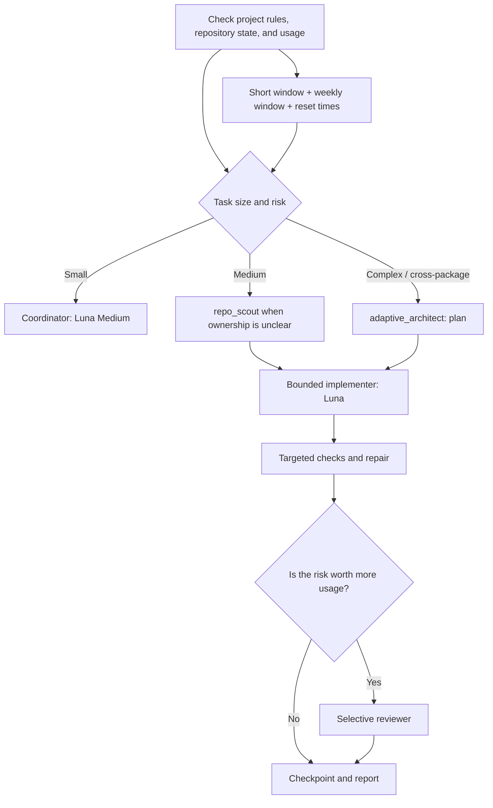

# Codex Tempo — adaptive workflow guidance for Codex

English documentation. [Русская версия →](README.md)

A set of Codex Desktop/CLI instructions, roles, skills, and a local plugin: model tier and parallelism follow the task, both usage windows and reset timers inform costly phases, and a separate gate prevents accidental comparative reviews when reserves are low or unknown.

> **Honest boundary:** this system helps conserve the shared Plus allowance by choosing the current work pace from the short window and using the weekly window as a planning horizon with a lower safety reserve. Future task usage is unknown and the allowance is shared across Codex and other supported ChatGPT experiences. The only way to guarantee no usage is to make no requests.

## What is included



The repository contains global `AGENTS.md` instructions, six roles, three Codex skills, a local plugin with an optional session-start reminder, a safe installer, a validator, a sanitized usage snapshot, and a quota recommendation helper. The core scripts make no model requests and do not change Fast.

## How it saves usage from the start of a window

At the beginning of a task and before each costly phase, the coordinator:

1. Reads `get_usage_limits` when available: remaining short-window usage, remaining weekly usage, and both reset times.
2. Identifies the limiting window and whether an optional phase can wait for its reset.
3. Weighs the next step: one model or truly independent roles, required reasoning depth, defect risk, and necessary checks.
4. Refreshes the snapshot after a costly phase. Other chats and devices can spend the shared allowance, so an old percentage is not treated as current.

Even at 100%, the system plans across the time until the weekly reset. Luna Medium remains the default; parallel agents, optional reviews, and escalations require a clear quality or time benefit. Dividing weekly usage remaining by days until reset is only an even-pacing reference. It is **not** a prediction of model or task cost.

The short window sets the current work pace and available parallelism: when it has room, useful stages and needed independent agents may run even if the weekly balance is low. If weekly balance is at or below 10% but resets within 2 hours, the guard continues useful work according to short-window headroom. If the reset is farther away, it pauses unless the user explicitly directs it to continue despite the weekly threshold. If the short window is nearly empty, resets soon, and the task can wait, the coordinator may checkpoint until its reset. When usage is unknown, the closed mode is Luna Medium, at most one subagent, no Astra, no parallel runs, and Fast off.

### Reserve thresholds

| Remaining in short or weekly window | Policy |
| --- | --- |
| Short-window balance at 50% or less | Remove optional reviewer and Astra; Luna remains the normal choice. |
| Short-window balance at 35% or less | Do not start new agent stages until the short window resets. |
| Weekly balance at 25% or less | Does not by itself restrict agents, model choice, or required checks; track the reset, refresh before costly stages, and continue according to short-window headroom. |
| Short-window balance at 25% or less | If the reset is near and the specific task can wait, checkpoint until the short-window reset. Otherwise continue only necessary work. |
| Weekly balance at 10% or less, reset within 2 hours | Do not pause; use short-window routing. |
| Weekly balance at 10% or less, reset more than 2 hours away | Stop costly stages unless the user explicitly directs continuation despite the weekly threshold. |
| Short-window balance at 10% or less | Stop new costly stages unless the user explicitly directs continuation; obey Codex's actual limit. |

Use the short window for work and concurrency thresholds. The weekly window sets the planning horizon; when it is close to reset, use short-window headroom for useful work. An explicit user direction to continue also overrides the weekly pause when the reset is farther away. The guard cannot bypass Codex's actual rate limit.

## Fast is a separate speed setting, not a model

In Codex, Fast is the separate UI toggle labeled “1.5× speed / More usage.” It is **not enabled automatically**, including at 100% remaining or just before a reset. Consider it only when:

- the task is urgent or latency materially matters;
- usage is visible, short-window balance is above 50%, and the weekly balance is above 10%, resets within 2 hours, or is explicitly overridden by the user;
- the time saved justifies the extra usage;
- it is limited to one bounded phase and turned off afterward.

Fast stays off when usage is unknown, the task can wait, or short-window balance is 50% or less. If weekly reset is near or the user explicitly overrides its threshold, low weekly usage does not block Fast when short-window headroom is sufficient and speed is justified. This package does not derive a fixed usage multiplier from “1.5×”: the interface indicates faster speed and more usage, while actual task usage depends on context and agent work. The system does not try to empty the short-window allowance for its own sake; it uses it only for useful work.

The installer preserves `service_tier = "default"` and does not control the UI. In Codex Desktop, use the lightning toggle; in versions that expose the command, `/fast` is also available. `scripts/quota_guard.py` can flag Fast for manual consideration but never turns it on. If the current agent has no supported UI action or command, it should name the phase where Fast is justified and ask the user to enable it, then remind them to turn it off afterward.

## Open-source integrations

| Project | Status | Role in this setup |
| --- | --- | --- |
| Codex skills and lifecycle hooks | Included | `adaptive-codex` defines the workflow; the SessionStart plugin reads only a short-lived sanitized quota snapshot and reminds the agent about reset times. |
| [MCO](https://github.com/mco-org/mco), MIT | Optional CLI, installed separately; its bundled skill is not required, and calls go through `mco_gate.py` | Optional read-only comparison for rare high-risk changes. The gate requires fresh usage, more than 50% in both windows, an explicitly chosen team of 2–3 providers, a narrow in-repository scope, and a separate `--execute`. |
| Official Codex app-server/SDK | Skill guidance is included; no persistent service is deployed | Useful when an application truly needs to create, resume, and monitor Codex threads programmatically. For everyday coding, built-in threads and `codex resume` are simpler and more economical. |
| A separate persistent orchestrator with its own workers | Not added | Codex already provides agent branches, worktrees, and resume. A second manager would duplicate these, add background processes, and make extra model calls. |

MCO does not save usage: each selected provider does its own work, and the `codex` provider uses the account’s shared allowance. Provider teams are never inferred, and MCO is not called for normal tasks. If needed, CLI 0.13.0 can be installed separately, without the additional skill that could bypass the gate:

```bash
npm install --global @tt-a1i/mco@0.13.0 --ignore-scripts --no-audit --no-fund
mco --version
```

The main `scripts/install.py` does not install third-party packages. If the CLI is already installed, do not install it again. Preview the exact call below and only execute after choosing a provider team:

```bash
python3 scripts/mco_gate.py \
  --repo /path/to/repository \
  --providers claude,codex \
  --target-paths src/important-module,tests/important-module \
  --prompt-file /path/to/review-prompt.txt
```

Preview does not launch providers. For a real read-only review, only after the user confirms the exact `claude,codex` team and the fresh usage is above the reserves:

```bash
python3 scripts/mco_gate.py \
  --repo /path/to/repository \
  --providers claude,codex \
  --target-paths src/important-module,tests/important-module \
  --confirm-provider-team claude,codex \
  --prompt-file /path/to/review-prompt.txt \
  --execute
```

The gate blocks actual dispatch when the snapshot is missing/stale, either window is at or below 50%, confirmation is absent, more than three providers are selected, whole-repository scope is requested instead of explicit paths, or the MCO CLI is unavailable. It passes only the selected paths, uses `read_only` and `strict` modes with a five-minute global timeout, and only runs `mco review`, never `mco run`. MCO path restrictions validate the requested scope but are not an operating-system sandbox; actual isolation depends on the provider CLI.

Ollama, LM Studio, and other local model providers are intentionally excluded from this package.

## Roles and models

| Role | Model | Use |
| --- | --- | --- |
| Coordinator | GPT-6 Luna, Medium | Requirements, routing, integration, and final verification. |
| `repo_scout` | GPT-6 Luna, High | Bounded map of code ownership and checks; read-only. |
| `implementer` | GPT-6 Luna, Medium | A scoped implementation with explicit file ownership. |
| `test_fixer` | GPT-6 Luna, Medium | Repair for a specific failure; at most two attempts. |
| `adaptive_architect` | GPT-6.1 Sol, High | Research and a plan for complex, risky, or cross-package work. |
| `reviewer` | GPT-6.1 Sol, Medium | Selective independent review after checks when the risk warrants the cost. |
| `escalation` | GPT-6 Astra, Medium | Rare escalation for a critical unresolved decision. |

If a model is not available for the current account/version, do not substitute a made-up identifier. Select an available Codex model or use Luna as the default route. Availability depends on product, plan, and rollout.

## Quick start

Requires Python 3.11+ (standard library) and Codex Desktop or CLI. Clone the repository into a normal working folder and run the single installer:

```bash
./install.sh
```

It finds a suitable Python, previews the plan, asks for confirmation, installs the package, and adds the local plugin. Restart Codex and inspect the SessionStart hook in **Settings → Hooks** before its first use.

To install the instructions manually without connecting the plugin, run:

```bash
python3.11 scripts/validate.py
python3.11 scripts/install.py --dry-run
python3.11 scripts/install.py
```

Restart Codex. Before the first run, open `/hooks` in the CLI or **Settings → Hooks** in the app, inspect the `SessionStart` command, and trust only its current contents. Codex skips unreviewed plugin hooks. This hook cannot block work and reads only `$CODEX_HOME/state/adaptive-quota.json`.

The installer:

- installs `AGENTS.md` and role TOMLs into `$CODEX_HOME` (or `~/.codex`);
- installs three skills into `$CODEX_HOME/skills/` and three helper scripts into `$CODEX_HOME/tools/adaptive-codex/`;
- adds/updates only managed `[agents]` keys in `config.toml`;
- preserves all other settings and user values;
- creates a separate backup of changed files under `backups/adaptive-codex-install/` before replacement; on a write error it attempts to roll back completed changes and reports the backup location;
- does not touch authentication, history, secrets, model settings, `service_tier`, working repositories, or projects.

`install.sh` connects the plugin separately from installing instructions and does not add hooks directly to `config.toml`. If setup stops while connecting the plugin, run `./install.sh` again; completed steps are skipped or safely repeated.

### Update, uninstall, and catalog package

- `./install.sh --check-updates` checks `origin/main` without changing the checkout.
- `./install.sh --update` fast-forwards a clean `main` checkout and reruns installation; local changes block the update.
- `./install.sh --uninstall` previews managed files, backs them up, and asks for confirmation. Marketplace plugin removal has a separate confirmation.
- `./install.sh --package` builds a skills-only ZIP under `dist/`; lifecycle hooks are excluded.

The catalog plugin is named Codex Tempo. The local marketplace keeps the SessionStart hook; the catalog package has a separate onboarding skill and square SVG icon.

### Store a fresh usage snapshot

When `get_usage_limits` is available in the current interface, pass only the used percentages and the Unix reset times to the snapshot helper:

```bash
python3 scripts/quota_snapshot.py record \
  --primary-used-percent 31 --primary-resets-at <unix-seconds> \
  --weekly-used-percent 79 --weekly-resets-at <unix-seconds> \
  --saved-reset-available

python3 scripts/quota_guard.py --snapshot "$CODEX_HOME/state/adaptive-quota.json"
```

If `CODEX_HOME` is unset, the snapshot lives at `~/.codex/state/adaptive-quota.json`. The helper stores only percentages, reset timestamps, and whether a saved reset is available—no `accountId`, reset-credit IDs, authentication, or raw tool response. Snapshots expire after 15 minutes. Refresh the official meter before every costly phase; the session hook displays only the last saved reading and does not query the account by itself.

Check a quota profile without account credentials or usage files:

```bash
python3 scripts/quota_guard.py \
  --primary-remaining 58 --primary-reset-in 3h \
  --weekly-remaining 24 --weekly-reset-in 6h
```

For this example, the recommendation is to continue useful work on Luna; short-window headroom permits up to two independent agents when they improve speed or quality. A low weekly balance above 10% does not by itself block these stages. If the weekly balance is 8% and its reset is more than two hours away, new costly stages stop unless the user explicitly directs continuation:

```bash
python3 scripts/quota_guard.py \
  --primary-remaining 58 --primary-reset-in 3h \
  --weekly-remaining 8 --weekly-reset-in 6h
```

If weekly usage is 9% but resets in 1h 31m, the system continues according to short-window headroom:

```bash
python3 scripts/quota_guard.py \
  --primary-remaining 92 --primary-reset-in 3h \
  --weekly-remaining 9 --weekly-reset-in 1h31m
```

`--user-authorized-continue` passes the user's explicit direction to ignore the weekly threshold; agent count still follows the short window. `--urgent` means the task cannot reasonably wait and latency has practical value. Then the script marks Fast as a manual candidate when short-window balance is above 50% and weekly balance is above 10%, resets within 2 hours, or is explicitly overridden. `--critical` marks a high-impact decision; recommending Sol also requires `--sol-authorized`, meaning the user confirmed sufficient remaining usage. No flag purchases usage, redeems a reset, or launches an agent.

### Example Codex prompts

```text
Check the project instructions and both usage windows with their reset times. Choose the smallest mode that can produce a verified result. Do not add an agent unless it reduces total risk or time.
```

```text
This is a complex change: first request only an evidence-based adaptive_architect plan with files, checks, and risks. Then stop at the proposed boundaries, refresh usage before each new phase, and delegate only non-overlapping work.
```

```text
This work is urgent. Check both windows and their reset times. If Fast is available and its economics make sense, tell me which bounded phase should use it; do not leave Fast on afterward.
```

In interactive CLI, resume long work with `codex resume`. In Codex Desktop, continue in the original chat/branch and leave a concise checkpoint with decisions and usage/reset times.

## Files

- `AGENTS.md` — coordinator instructions for the current task.
- `agents/*.toml` — six named Codex roles.
- `config/agents.toml` — documented agent configuration fragment.
- `scripts/install.py` — safe installation with backups.
- `install.sh` — one-command interactive installation of the package and local plugin.
- `scripts/quota_snapshot.py` — short-lived quota snapshot storage with `0600` file permissions.
- `scripts/quota_guard.py` — recommendation from both remaining percentages, reset timers, urgency, and criticality; it makes no model calls.
- `scripts/mco_gate.py` — optional gate for a confirmed read-only MCO review.
- `skills/` — the main workflow and two focused guides for MCO and official Codex app-server.
- `plugins/adaptive-quota/` — marketplace plugin and safe SessionStart hook.
- `scripts/validate.py` — structural validation of roles and required policy.
- `tests/` — installer, reset/threshold, private snapshot, hook, and MCO gate tests.

## Permissions, privacy, and limits

- “Read-only” in a role prompt is an instruction, not an isolated security boundary. Subagents inherit the parent session's permissions. Review actual diffs.
- Do not copy `auth.json`, `.env`, session history, logs, working files, or backups into this repository. `.gitignore` excludes the common forms of this local state.
- `get_usage_limits` is not exposed in every local CLI/context. If unavailable, the system does not read credential files or pretend to know exact remaining usage.
- Codex Plus usage is shared with other chats/devices. This package cannot control usage outside the current task or stop another chat from consuming the account allowance.
- Models, Fast, and parallelism do not guarantee error-free work. Checks and review reduce risk but also consume resources.
- If the meter shows a saved free reset, the coordinator can report it when it could avoid waiting. A reset is never redeemed automatically, availability conditions are respected, and each use needs an explicit user decision.

## Tested environment

Validated on macOS with Codex Desktop `26.1103.41825`, its bundled CLI `0.167.0-alpha.3.2`, and the separately installed CLI `0.163.0`. The checks use only the Python 3.11+ standard library. The interface, model names, and `/fast` availability may change with Codex updates.

## Official references

- [ChatGPT and Codex usage limits](https://help.openai.com/en/articles/20001625-understanding-chatgpt-and-codex-usage-limits)
- [Response speed and resets in Work and Codex](https://help.openai.com/en/articles/20001596-response-speed-and-usage-resets-in-work-and-codex)
- [Using Codex with your ChatGPT plan](https://help.openai.com/en/articles/11369540-using-codex-with-your-chatgpt-plan)
- [Codex subagents](https://developers.openai.com/codex/subagents/)
- [Codex configuration reference](https://developers.openai.com/codex/config-reference/)
- [Codex plugins and lifecycle hooks](https://developers.openai.com/plugins/build/plugins)
- [Reviewing and trusting hooks](https://developers.openai.com/codex/hooks)
- [Official Codex app-server/SDK](https://developers.openai.com/blog/codex-as-a-platform)
- [MCO source, license, and instructions](https://github.com/mco-org/mco)
