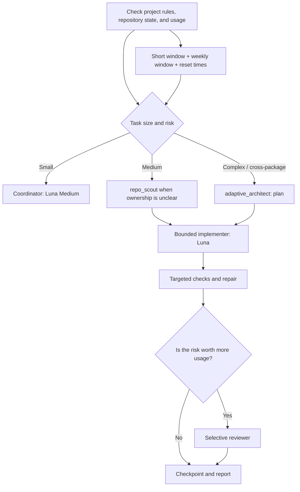

# `.codex` — adaptive development with quota awareness

English documentation. [Русская версия →](README.md)

A set of Codex Desktop/CLI instructions and roles: stronger models are reserved for work that benefits from them, implementers receive bounded file ownership, and both remaining usage and reset times inform each substantial phase.

> **Honest boundary:** this system helps conserve the shared Plus allowance and pauses work before optional stages become risky. It cannot guarantee zero chance of exhaustion: usage is shared across Codex and other supported ChatGPT experiences, and the cost of a future task is not known exactly. The only way to guarantee no usage is to make no requests.

## What is included



The repository contains global `AGENTS.md` instructions, six custom roles, a safe installer, a validator, and a helper that recommends a mode from both usage windows and their reset timers. The helper does not send model requests or change the speed toggle.

## How it saves usage from the start of a window

At the beginning of a task and before each costly phase, the coordinator:

1. Reads `get_usage_limits` when available: remaining short-window usage, remaining weekly usage, and both reset times.
2. Identifies the limiting window and whether an optional phase can wait for its reset.
3. Weighs the next step: one model or truly independent roles, required reasoning depth, defect risk, and necessary checks.
4. Refreshes the snapshot after a costly phase. Other chats and devices can spend the shared allowance, so an old percentage is not treated as current.

Even at 100%, the system plans across the time until the weekly reset. Luna Medium remains the default; parallel agents, optional reviews, and escalations require a clear quality or time benefit. Dividing weekly usage remaining by days until reset is only an even-pacing reference. It is **not** a prediction of model or task cost.

When usage is low and the limiting window resets soon, non-urgent work gets a checkpoint and waits. If the user explicitly asks to continue, the coordinator may do the minimum necessary step. When usage is unknown, the closed mode is Luna Medium, at most one subagent, no Astra, no parallel runs, and Fast off.

### Reserve thresholds

| Remaining in either window | Policy |
| --- | --- |
| 50% or less | Remove optional reviewer and Astra; Luna remains the normal choice. |
| 35% or less | Do not start new agent stages. |
| 25% or less | Finish only a short safe step, checkpoint, and wait for reset unless the user explicitly directs continuation. |
| 10% or less | Do not run optional model stages. |

Use the more constrained visible window. These thresholds are not estimates of the cost of a particular task or agent.

## Fast is a separate speed setting, not a model

In Codex, Fast is the separate UI toggle labeled “1.5× speed / More usage.” It is **not enabled automatically**, including at 100% remaining or just before a reset. Consider it only when:

- the task is urgent or latency materially matters;
- usage is visible and both windows have enough headroom;
- the time saved justifies the extra usage;
- it is limited to one bounded phase and turned off afterward.

Fast stays off when weekly usage is low or unknown, the task can wait, or the limiting window is close to reset. This package does not derive a fixed usage multiplier from “1.5×”: the interface indicates faster speed and more usage, while actual task usage depends on context and agent work.

The installer preserves `service_tier = "default"` and does not control the UI. In Codex Desktop, use the lightning toggle; in versions that expose the command, `/fast` is also available. `scripts/quota_guard.py` can flag Fast for manual consideration but never turns it on.

## Roles and models

| Role | Model | Use |
| --- | --- | --- |
| Coordinator | GPT-6 Luna, Medium | Requirements, routing, integration, and final verification. |
| `repo_scout` | GPT-6 Luna, High | Bounded map of code ownership and checks; read-only. |
| `implementer` | GPT-6 Luna, Medium | A scoped implementation with explicit file ownership. |
| `test_fixer` | GPT-6 Luna, Medium | Repair for a specific failure; at most two attempts. |
| `adaptive_architect` | GPT-6.1 Sol, High | Research and a plan for complex, risky, or cross-package work. |
| `reviewer` | GPT-6.1 Sol, Medium | Selective independent review after checks when the risk warrants the cost. |
| `escalation` | GPT-6 Astra, Medium | Rare escalation for a critical unresolved decision. |

If a model is not available for the current account/version, do not substitute a made-up identifier. Select an available Codex model or use Luna as the default route. Availability depends on product, plan, and rollout.

## Quick start

Requires Python 3.11+ (standard library) and Codex Desktop or CLI. Clone the private repository into a normal working folder, then run:

```bash
python3 scripts/validate.py
python3 -m unittest discover -s tests -v
python3 scripts/install.py --dry-run
python3 scripts/install.py
```

The installer:

- installs `AGENTS.md` and role TOMLs into `$CODEX_HOME` (or `~/.codex`);
- adds/updates only managed `[agents]` keys in `config.toml`;
- preserves all other settings and user values;
- creates backups of changed files before replacement at `backups/adaptive-codex-install/<UTC timestamp>/`;
- does not touch authentication, history, secrets, model settings, `service_tier`, working repositories, or projects.

Check a quota profile without account credentials or usage files:

```bash
python3 scripts/quota_guard.py \
  --primary-remaining 58 --primary-reset-in 3h \
  --weekly-remaining 24 --weekly-reset-in 6h
```

For this example, the default recommendation is to pause until the weekly reset, with Fast off. To model an explicit user request to continue:

```bash
python3 scripts/quota_guard.py \
  --primary-remaining 58 --primary-reset-in 3h \
  --weekly-remaining 24 --weekly-reset-in 6h \
  --user-authorized-continue
```

`--urgent` means the task cannot reasonably wait and latency has practical value. Even then, the script only marks Fast as a manual candidate when **both** windows are above the reserve. `--critical` marks a high-impact decision; recommending Sol also requires `--sol-authorized`, meaning the user confirmed sufficient remaining usage. No flag purchases usage, redeems a reset, or launches an agent.

### Example Codex prompts

```text
Check the project instructions and both usage windows with their reset times. Choose the smallest mode that can produce a verified result. Do not add an agent unless it reduces total risk or time.
```

```text
This is a complex change: first request only an evidence-based adaptive_architect plan with files, checks, and risks. Then stop at the proposed boundaries, refresh usage before each new phase, and delegate only non-overlapping work.
```

```text
This work is urgent. Check both windows and their reset times. If Fast is available and its economics make sense, tell me which bounded phase should use it; do not leave Fast on afterward.
```

In interactive CLI, resume long work with `codex resume`. In Codex Desktop, continue in the original chat/branch and leave a concise checkpoint with decisions and usage/reset times.

## Files

- `AGENTS.md` — coordinator instructions for the current task.
- `agents/*.toml` — six named Codex roles.
- `config/agents.toml` — documented agent configuration fragment.
- `scripts/install.py` — safe installation with backups.
- `scripts/quota_guard.py` — recommendation from both remaining percentages, reset timers, urgency, and criticality; it makes no model calls.
- `scripts/validate.py` — structural validation of roles and required policy.
- `tests/test_quota_guard.py` — targeted timer and threshold tests.

## Permissions, privacy, and limits

- “Read-only” in a role prompt is an instruction, not an isolated security boundary. Subagents inherit the parent session's permissions. Review actual diffs.
- Do not copy `auth.json`, `.env`, session history, logs, working files, or backups into this repository. `.gitignore` excludes the common forms of this local state.
- `get_usage_limits` is not exposed in every local CLI/context. If unavailable, the system does not read credential files or pretend to know exact remaining usage.
- Codex Plus usage is shared with other chats/devices. This package cannot control usage outside the current task or stop another chat from consuming the account allowance.
- Models, Fast, and parallelism do not guarantee error-free work. Checks and review reduce risk but also consume resources.
- If the meter shows a saved free reset, the coordinator can report it when it could avoid waiting. A reset is never redeemed automatically, availability conditions are respected, and each use needs an explicit user decision.

## Tested environment

Validated on macOS with Codex Desktop `26.1103.41825`, its bundled CLI `0.167.0-alpha.3.2`, and the separately installed CLI `0.163.0`. The checks use only the Python 3.11+ standard library. The interface, model names, and `/fast` availability may change with Codex updates.

## Official references

- [ChatGPT and Codex usage limits](https://help.openai.com/en/articles/20001625-understanding-chatgpt-and-codex-usage-limits)
- [Response speed and resets in Work and Codex](https://help.openai.com/en/articles/20001596-response-speed-and-usage-resets-in-work-and-codex)
- [Using Codex with your ChatGPT plan](https://help.openai.com/en/articles/11369540-using-codex-with-your-chatgpt-plan)
- [Codex subagents](https://developers.openai.com/codex/subagents/)
- [Codex configuration reference](https://developers.openai.com/codex/config-reference/)
