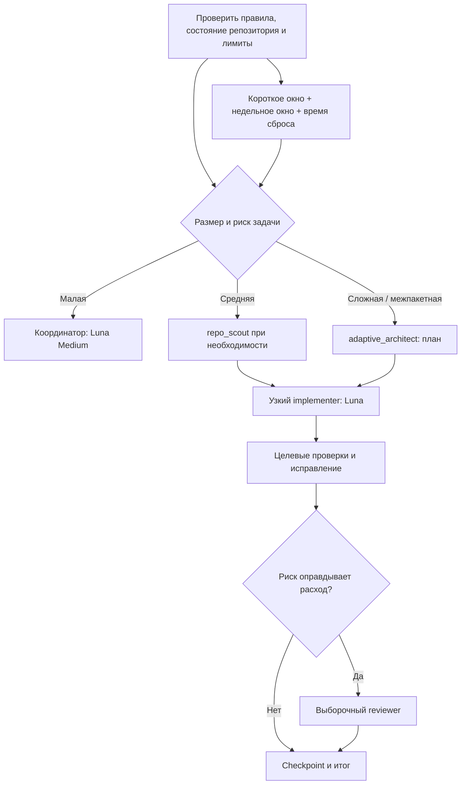

# `.codex` — адаптивная разработка с контролем квот

Русская документация. [English version →](README.en.md)

Набор правил, ролей, skills и локального плагина для Codex Desktop/CLI: модели и параллельность выбираются под задачу, оба окна использования и таймеры сброса проверяются перед затратными этапами, а отдельный шлюз не даёт случайно запустить сравнительное ревью при низком или неизвестном запасе.

> **Честная граница:** система помогает беречь общий лимит Plus и вовремя ставит работу на паузу. Она не может гарантировать нулевой риск исчерпания: лимит общий для Codex и других поддерживаемых режимов ChatGPT, а точный расход будущего задания заранее неизвестен. Чтобы вообще исключить расход, пришлось бы не отправлять запросы.

## Что внутри



В комплект входят глобальные инструкции `AGENTS.md`, шесть ролей, три Codex skills, локальный plugin с необязательной подсказкой при старте сессии, безопасный установщик, валидатор, снимок счётчика и расчёт рекомендаций. Основные скрипты не отправляют запросы моделям и не меняют Fast.

## Как система экономит с самого начала окна

Полный лимит не трактуется как разрешение потратить его на один проект. Перед задачей и перед каждым затратным этапом координатор:

1. Читает доступный `get_usage_limits`: остаток короткого окна, остаток недельного окна и время каждого сброса.
2. Выявляет ограничивающее окно и соотносит его таймер с тем, можно ли безопасно отложить задачу.
3. Оценивает пользу следующего шага: одна модель или действительно независимые роли, нужная глубина рассуждения, риск ошибки и обязательные проверки.
4. Использует обновлённый снимок после затратного этапа. Другие чаты и устройства могут расходовать общий остаток, поэтому старые проценты не считаются актуальными.

Когда доступно 100%, система всё равно держит в уме весь срок до недельного сброса: выбирает Luna Medium по умолчанию, не запускает параллельных агентов без выигрыша по времени/качеству и оставляет необязательные ревью и эскалации на случай реальной необходимости. Показатель «остаток недельного окна ÷ дни до сброса» можно использовать только как ориентир равномерного темпа; он **не** предсказывает расход конкретной модели.

Если лимит мал, а ограничивающее окно скоро сбрасывается, несрочная работа получает checkpoint и ждёт сброса. Если пользователь прямо просит продолжить, координатор может выполнить минимальный необходимый шаг с учётом этого указания. При неизвестном лимите включается закрытый режим: Luna Medium, не более одного агента, без Astra, параллельных прогонов и Fast.

### Резервные пороги

| Остаток любого окна | Режим |
| --- | --- |
| 50% и меньше | Убрать необязательный reviewer и Astra; Luna остаётся обычным выбором. |
| 35% и меньше | Не начинать новые агентские этапы. |
| 25% и меньше | Завершить только короткий безопасный шаг, сохранить checkpoint и ждать сброса, если пользователь явно не попросил продолжить. |
| 10% и меньше | Не запускать необязательные модельные прогоны. |

Пороги применяются к более ограничивающему из видимых окон. Они не являются оценкой того, сколько процентов «стоит» агент или задача.

## Fast — отдельная скорость, не модель

В Codex Fast — отдельный переключатель интерфейса с подписью «Скорость 1,5× / Больше использования». Поэтому Fast **не включается автоматически**, в том числе при 100% остатке или близком сбросе. Он может быть уместен только когда:

- задача действительно срочная или задержка заметно мешает;
- счётчик доступен и в обоих окнах остаётся достаточный запас;
- выигрыш от скорости оправдывает большее использование;
- режим ограничен одним конкретным этапом и затем выключается.

При низком/неизвестном недельном остатке, не срочной задаче или скором сбросе ограничивающего окна Fast остаётся выключенным. Набор не выводит точный множитель расхода из «1,5×»: интерфейс показывает скорость и большее использование, но стоимость конкретной задачи зависит от контекста и работы агента.

Установщик сохраняет `service_tier = "default"` и не пытается управлять UI. В Codex Desktop используйте переключатель молнии; в версиях, где команда доступна, можно вызвать `/fast`. `scripts/quota_guard.py` сообщает, можно ли рассматривать Fast вручную, но сам его не включает. Если в текущем сеансе у агента нет поддерживаемого UI-действия или команды, он должен назвать этап, где Fast оправдан, и попросить пользователя включить его; после этапа напомнить выключить.

## Интеграции с open-source решениями

| Решение | Статус | Для чего оно здесь |
| --- | --- | --- |
| Codex skills и lifecycle hooks | Включены в комплект | `adaptive-codex` задаёт рабочий процесс; SessionStart plugin подхватывает только короткий безопасный снимок квоты и напоминает о сбросах. |
| [MCO](https://github.com/mco-org/mco), MIT | CLI 0.13.0 установлен отдельно; bundled skill не устанавливается, вызовы идут только через `mco_gate.py` | Дополнительное read-only сравнение для редких высокорисковых изменений. Шлюз требует свежие данные, больше 50% в обоих окнах, явный выбор 2–3 провайдеров, узкую область внутри репозитория и отдельный `--execute`. |
| Официальный Codex app-server/SDK | Подготовлена инструкция skill; постоянно работающий сервис не развёрнут | Подходит приложению, которому действительно нужно программно создавать, возобновлять и отслеживать потоки Codex. Для обычной разработки проще и экономнее встроенные чаты и `codex resume`. |
| Отдельный постоянный оркестратор с собственными worker-ами | Не добавлен | В текущем Codex уже есть ветки агентов, worktree и resume. Второй менеджер дублировал бы их, создавал фоновые процессы и дополнительные модельные вызовы. |

MCO не экономит лимит: каждый выбранный провайдер делает свою работу, а `codex` использует общий лимит аккаунта. Поэтому команда не подбирается автоматически и MCO не запускается при обычной задаче. CLI 0.13.0 проверен и установлен отдельно, без дополнительного skill, который мог бы обходить шлюз:

```bash
npm install --global @tt-a1i/mco@0.13.0 --ignore-scripts --no-audit --no-fund
mco --version
```

Основной `scripts/install.py` не устанавливает сторонние пакеты. Если CLI уже установлен, повторно ставить его не нужно. Сначала выполните preview ниже и запускайте только после выбора команды провайдеров:

```bash
python3 scripts/mco_gate.py \
  --repo /path/to/repository \
  --providers claude,codex \
  --target-paths src/important-module,tests/important-module \
  --prompt-file /path/to/review-prompt.txt
```

Preview ничего не запускает. Для реального read-only ревью, только если пользователь подтвердил именно `claude,codex` и свежий лимит выше порогов:

```bash
python3 scripts/mco_gate.py \
  --repo /path/to/repository \
  --providers claude,codex \
  --target-paths src/important-module,tests/important-module \
  --confirm-provider-team claude,codex \
  --prompt-file /path/to/review-prompt.txt \
  --execute
```

Скрипт блокирует реальный запуск при неизвестном/устаревшем снимке, остатке 50% или ниже, отсутствии подтверждения, более чем трёх провайдерах, полном репозитории вместо явно заданного scope или отсутствии MCO CLI. Он передаёт MCO только указанные пути, задаёт `read_only`, `strict` и общий таймаут пять минут. Path restrictions в MCO проверяют заявленную область, но не являются системной песочницей; реальную изоляцию определяет конкретный provider CLI. Запускается только `mco review`, никогда не `mco run`.

Поддержка Ollama, LM Studio и других локальных model providers намеренно исключена из этого набора.

## Роли и модели

| Роль | Модель | Для чего |
| --- | --- | --- |
| Координатор | GPT-6 Luna, Medium | Требования, выбор режима, интеграция и итоговая проверка. |
| `repo_scout` | GPT-6 Luna, High | Узкая карта кода, владельца контракта и проверок; только чтение. |
| `implementer` | GPT-6 Luna, Medium | Реализация ограниченного участка с явными границами файлов. |
| `test_fixer` | GPT-6 Luna, Medium | Исправления по конкретной ошибке; не более двух попыток. |
| `adaptive_architect` | GPT-6.1 Sol, High | Исследование и план для сложной, рискованной или межпакетной задачи. |
| `reviewer` | GPT-6.1 Sol, Medium | Независимое выборочное ревью после проверок, только если риск оправдывает расход. |
| `escalation` | GPT-6 Astra, Medium | Редкая эскалация критичного нерешённого решения. |

Если модель не доступна в конкретном аккаунте/версии, не подменяйте её выдуманным идентификатором: выберите доступную модель в Codex или используйте Luna как стандартный маршрут. Доступность зависит от продукта, плана и раскатки.

## Быстрый старт

Требуется Python 3.11+ (стандартная библиотека), Codex Desktop или Codex CLI. Клонируйте приватный репозиторий в обычную рабочую папку, затем выполните:

```bash
python3 scripts/validate.py
python3 -m unittest discover -s tests -v
python3 scripts/install.py --dry-run
python3 scripts/install.py
```

Чтобы добавить плагин в Codex Desktop/CLI из клона приватного репозитория:

```bash
codex plugin marketplace add /absolute/path/to/.codex
codex plugin add adaptive-quota@adaptive-codex
```

Перезапустите Codex. Перед первым запуском откройте `/hooks` в CLI или **Settings → Hooks** в приложении, проверьте команду `SessionStart` и доверяйте только её актуальному содержимому. Codex пропускает непроверенные plugin hooks. Хук ничего не блокирует и читает только `$CODEX_HOME/state/adaptive-quota.json`.

Установщик:

- устанавливает `AGENTS.md` и TOML-роли в `$CODEX_HOME` (или `~/.codex`);
- ставит три skills в `$CODEX_HOME/skills/` и три служебных скрипта в `$CODEX_HOME/tools/adaptive-codex/`;
- добавляет/обновляет только контролируемые ключи `[agents]` в `config.toml`;
- сохраняет остальные настройки и значения пользователя;
- перед заменой создаёт резервные копии изменяемых файлов в `backups/adaptive-codex-install/<UTC timestamp>/`;
- не трогает авторизацию, историю, секреты, настройки моделей, `service_tier`, рабочие репозитории и проекты.

Плагин устанавливается отдельно командой выше, чтобы явно показать момент его подключения и доверия к hook. Обычная установка не добавляет hook напрямую в `config.toml`.

### Сохранить свежий снимок счётчика

Если в текущем интерфейсе доступен `get_usage_limits`, после чтения счётчика передайте скрипту только использованные проценты и Unix-время двух сбросов:

```bash
python3 scripts/quota_snapshot.py record \
  --primary-used-percent 31 --primary-resets-at <unix-seconds> \
  --weekly-used-percent 79 --weekly-resets-at <unix-seconds> \
  --saved-reset-available

python3 scripts/quota_guard.py --snapshot "$CODEX_HOME/state/adaptive-quota.json"
```

Если `CODEX_HOME` не задан, снимок хранится в `~/.codex/state/adaptive-quota.json`. Скрипт принимает и сохраняет только проценты, таймеры и факт доступного reset — без `accountId`, ID reset-кредитов, авторизации или полного ответа инструмента. Срок годности снимка — 15 минут. Перед каждым затратным этапом снова читайте официальный счётчик; хук сессии показывает лишь последнее сохранённое состояние, а не опрашивает аккаунт сам.

Проверка профиля без реальных токенов/данных аккаунта:

```bash
python3 scripts/quota_guard.py \
  --primary-remaining 58 --primary-reset-in 3h \
  --weekly-remaining 24 --weekly-reset-in 6h
```

Результат для примера выше — пауза до недельного сброса по умолчанию, Fast выключен. Чтобы проверить сценарий, в котором пользователь прямо распорядился продолжить:

```bash
python3 scripts/quota_guard.py \
  --primary-remaining 58 --primary-reset-in 3h \
  --weekly-remaining 24 --weekly-reset-in 6h \
  --user-authorized-continue
```

`--urgent` означает, что задача не может ждать и скорость имеет практическую ценность. Даже тогда скрипт лишь отмечает Fast как кандидата для ручного выбора, когда **оба** окна выше резерва. `--critical` помечает решение с высоким влиянием; чтобы порекомендовать Sol, также требуется `--sol-authorized` — пользователь подтвердил достаточный остаток. Никакие флаги не покупают лимит, не применяют reset и не запускают агента.

### Примеры запросов в Codex

```text
Проверь правила проекта и оба лимита вместе со временем до сброса. Сначала выбери минимальный режим, который даст проверенный результат. Не добавляй агента, если это не снизит общий риск или время.
```

```text
Сделай сложное изменение: сначала только план adaptive_architect с фактами, файлами, проверками и рисками. Затем остановись на границах работ, проверь актуальные лимиты перед каждым новым этапом и делегируй непересекающиеся участки.
```

```text
Работа срочная. Проверь два окна и reset-время. Если Fast в текущем интерфейсе доступен и экономически оправдан, сообщи, на каком ограниченном этапе его включить; не оставляй режим включённым после этапа.
```

В интерактивном CLI продолжайте долгую задачу через `codex resume`. В Codex Desktop используйте исходный чат/ветку; оставляйте короткий checkpoint с решениями и остатком/сбросами.

## Файлы

- `AGENTS.md` — правила координатора для текущей задачи.
- `agents/*.toml` — шесть именованных ролей Codex.
- `config/agents.toml` — документированный фрагмент настроек агентов.
- `scripts/install.py` — безопасная установка с резервным копированием.
- `scripts/quota_snapshot.py` — запись/чтение краткоживущего снимка лимитов с правами `0600`.
- `scripts/quota_guard.py` — расчёт режима по двум остаткам, таймерам, срочности и критичности; не вызывает модели.
- `scripts/mco_gate.py` — опциональный шлюз для подтверждённого read-only MCO review.
- `skills/` — основной процесс и две узкие инструкции для MCO и официального Codex app-server.
- `plugins/adaptive-quota/` — marketplace plugin и безопасный SessionStart hook.
- `scripts/validate.py` — структурная проверка ролей и обязательных правил.
- `tests/` — тесты установки, таймеров/порогов, приватного снимка, hook и блокировок MCO gate.

## Разрешения, приватность и ограничения

- Роль с инструкцией «только чтение» не получает отдельную системную границу безопасности. Субагенты наследуют разрешения главного сеанса. Реальный diff нужно проверять.
- Не копируйте в репозиторий `auth.json`, `.env`, историю сеансов, логи, рабочие файлы и бэкапы. `.gitignore` исключает основные типы такого состояния.
- Инструмент `get_usage_limits` доступен не в каждом локальном CLI/контексте. Если он отсутствует, система не читает секретные файлы и не делает вид, что знает точный остаток.
- Codex Plus использует общий лимит, который могут расходовать другие чаты/устройства. Профильный скрипт не управляет использованием аккаунта вне текущей задачи и не может физически остановить сторонний чат.
- Ни модели, ни Fast, ни параллельность не обещают отсутствие ошибок. Проверки и ревью уменьшают риск, но сами требуют ресурсов.
- Если счётчик показывает сохранённый бесплатный reset, координатор может сообщить об этом, когда reset поможет избежать ожидания. Reset не применяется автоматически и не обходятся ограничения доступности; для использования нужно явное решение пользователя.

## Проверенная среда

Комплект проверен на macOS с Codex Desktop `26.1103.41825`, встроенным CLI `0.167.0-alpha.3.2` и отдельно установленным CLI `0.163.0`. Команды тестов используют только стандартную библиотеку Python 3.11+. Интерфейс, названия моделей и доступность `/fast` могут меняться с обновлениями Codex.

## Официальные справки

- [Лимиты ChatGPT и Codex](https://help.openai.com/en/articles/20001625-understanding-chatgpt-and-codex-usage-limits)
- [Скорость и сбросы в Work и Codex](https://help.openai.com/en/articles/20001596-response-speed-and-usage-resets-in-work-and-codex)
- [Использование Codex с планом ChatGPT](https://help.openai.com/en/articles/11369540-using-codex-with-your-chatgpt-plan)
- [Подагенты Codex](https://developers.openai.com/codex/subagents/)
- [Справка по конфигурации Codex](https://developers.openai.com/codex/config-reference/)
- [Codex plugins и lifecycle hooks](https://developers.openai.com/plugins/build/plugins)
- [Проверка и доверие к hooks](https://developers.openai.com/codex/hooks)
- [Официальный Codex app-server/SDK](https://developers.openai.com/blog/codex-as-a-platform)
- [MCO: исходный код, лицензия и инструкции](https://github.com/mco-org/mco)
